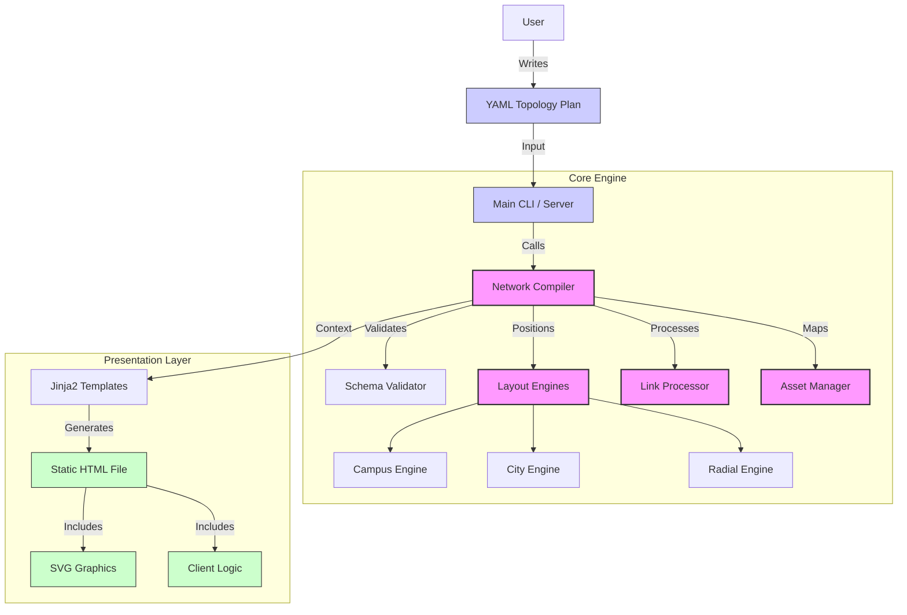

# Architecture Overview

This document outlines the high-level architecture of the Network Topology Generator. The system is designed as a modular, engine-based application that transforms YAML topology definitions into interactive HTML diagrams.

## System Components

The application consists of three main layers:

1. **Input Layer**:
  - **YAML Parser**: Reads user-defined topology files.
  - **Validator**: Ensures the input adheres to the strict schema definitions.

2. **Core Engine**:
  - **Network Compiler**: The orchestration brain that coordinates the build process.
  - **Layout Engines**: Algorithms that calculate node positions (Campus, City, Radial, Hierarchical).
  - **Asset Injector**: Handles icon mapping and path normalization.
  - **Link Processor**: Processes physical and logical connections, including auto-bundling.

3. **Presentation Layer**:
  - **Jinja2 Templating**: Generates the final static HTML output.
  - **Flask Server**: Provides a live development environment with an integrated editor.
  - **Frontend**: Interactive SVG rendering using vanilla JavaScript and CSS.

## Architecture Diagram

## Data Flow

1. **Initialization**: The `main.py` entry point initializes the `NetworkCompiler`.
2. **Loading**: The compiler reads the `input/plan.yaml` file.
3. **Validation**: `SchemaValidator` checks for required fields, valid IDs, and correct types.
4. **Layout Calculation**:
  - Nodes are assigned coordinates based on the selected engine.
  - If `x/y` are manual, they are preserved.
  - If automatic, the layout engine (e.g., `hierarchical`) calculates positions.
5. **Graph Construction**:
  - Nodes are formalized.
  - Links are established, and port/IP data is attached.
  - Groups are calculated (hulls or rects).
6. **Rendering**:
  - Context data (nodes, edges, config) is passed to `templates/diagram.html`.
  - The template renders the final self-contained HTML file.

## Key Modules

- **`engine.core.compiler`**: contains `NetworkCompiler`, the main orchestrator.
- **`engine.core.validator`**: contains `SchemaValidator` for schema enforcement.
- **`engine.layouts`**: Directory containing specific layout logic (`campus.py`, `hierarchical.py`, etc.).
- **`server.py`**: Flask application for the live preview and editor.
