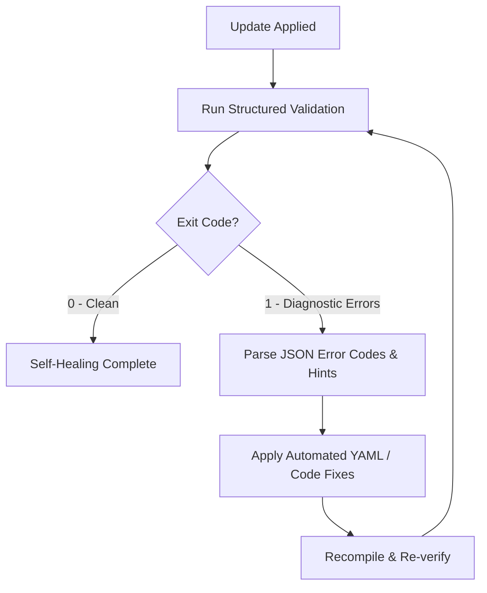

When an AI agent operates within Marrow, it is responsible for maintaining environmental integrity, checking for skill/toolchain updates, and autonomously repairing minor issues introduced by upstream changes.

## Update Check Workflow

During execution, the agent should periodically check for toolchain and skill updates:

```bash
npx skills check                  # Check installed skills against their upstream sources
npm outdated                      # Check workspace dependencies (optional)
```

The agent categorizes every detected update into one of two tiers:

| Update Tier | Definition | Action |
| :--- | :--- | :--- |
| **Tier 1: Safe / Patch** | Bug fixes, non-breaking skill improvements, internal optimizations, or added documentation that do not alter existing schema contracts or workspace configurations. | Update automatically without touching user configuration or unrelated project code. |
| **Tier 2: Impacting / Breaking** | Changes that modify YAML schema validation, deprecate root or device keys, alter layout placement geometry, change icon identifiers, or affect existing output HTML files. | **Pause and alert the user.** Detail the exact impact and wait for explicit user authorization before updating. |

---

## Impact Notification & Authorization Protocol

If a Tier 2 update is detected, the agent **must not** apply the update silently. It must prompt the user with an explicit impact brief:

1. **What is updating**: Package or skill name and versions (`v1.2.0 → v2.0.0`).
2. **What will be affected**: Affected topology files in `input/`, configuration keys in `marrow.config.yaml`, or output behaviors.
3. **Potential risks**: Deprecated keys requiring migration, visual layout shifts, or required rebuilds.
4. **Authorization request**: Ask the user directly whether to proceed with the update and migration.

Only proceed with the update once the user gives explicit consent.

---

## Autonomous Self-Healing Loop

Upstream updates may occasionally cause minor regressions: renamed YAML attributes, newly required fields, deprecated icon IDs, or compiler warnings. When this occurs, **the agent does not stop or request user intervention for trivial fixes**. Instead, it executes the autonomous self-healing loop:



### 1. Detect & Diagnose
Run the validator with `--json` to obtain machine-readable diagnostics:

```bash
npm run marrow -- validate input/<file>.yaml --json
```

Diagnostics return structured fields:
- `code`: Stable error code (e.g. `MRW-E001`, `MRW-E010`).
- `line` & `column`: Exact source location.
- `hint`: Actionable remediation guidance.
- `suggestions`: Ranked replacements for renamed keys or missing icon IDs.

### 2. Autonomous Remediation
The agent patches the issue directly:
- **Deprecated or renamed keys**: Update the YAML keys according to the new schema (e.g., migrating legacy annotations).
- **Missing or reorganized icons**: Query `npm run marrow -- icons search <keyword>` to identify the verified replacement ID and update the device node.
- **Uncompiled runtime or styles**: Run `npm run compile` to synchronize the runtime engine with updated dependencies.
- **Icon pack index**: Run `npm run icons:index` if vendor icon packs were updated.

### 3. Verification
Re-run validation and headless visual snapshotting:

```bash
npm run marrow -- validate input/<file>.yaml
npm run marrow -- snapshot input/<file>.yaml -o /tmp/verify.png
```

Validation must exit with code `0` before the agent considers the self-healing process complete.

---

## Escalation Boundaries

The agent heals minor regressions automatically, but **must escalate** to the user under the following conditions:

- The update requires deleting or fundamentally altering user network data (e.g., removing unmapped subnets or links).
- The update breaks custom integration scripts outside Marrow's core compiler.
- Self-healing cannot reach exit code `0` after iterative attempts.
- The update involves sensitive security credentials or changes external repository remotes.
